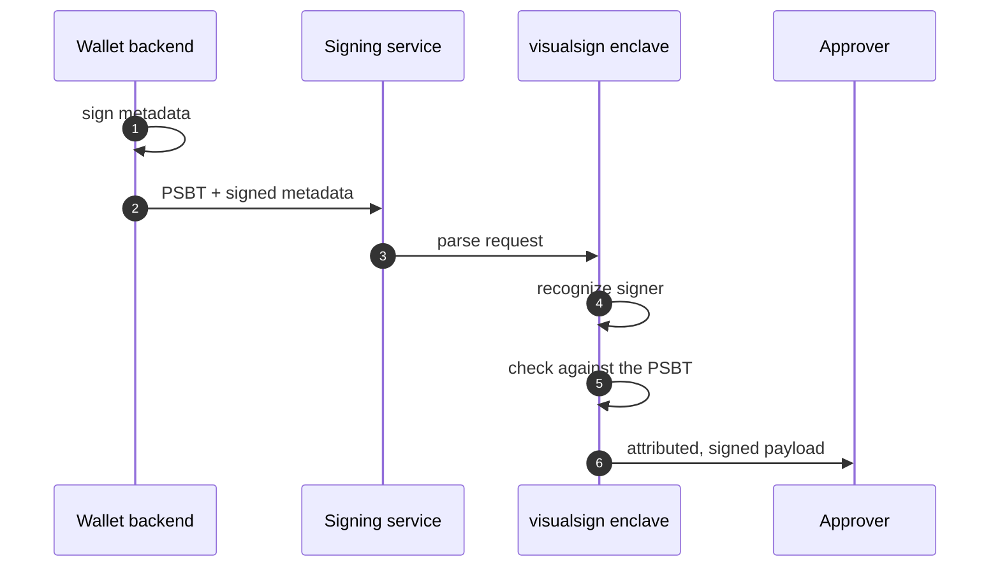
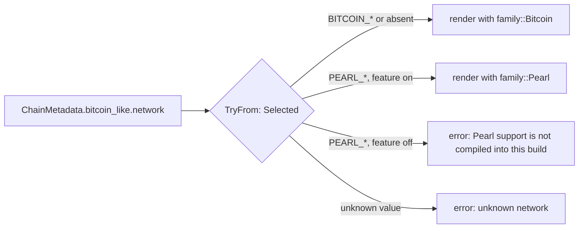
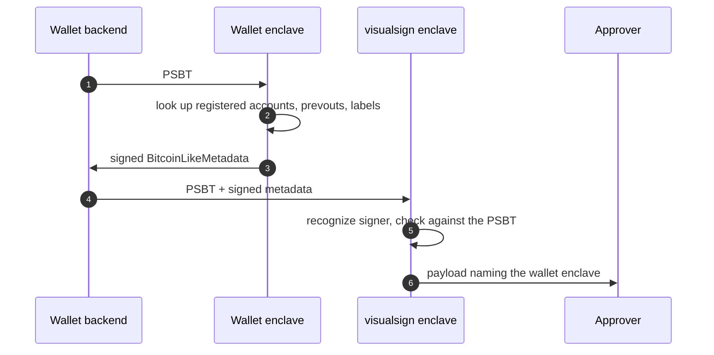
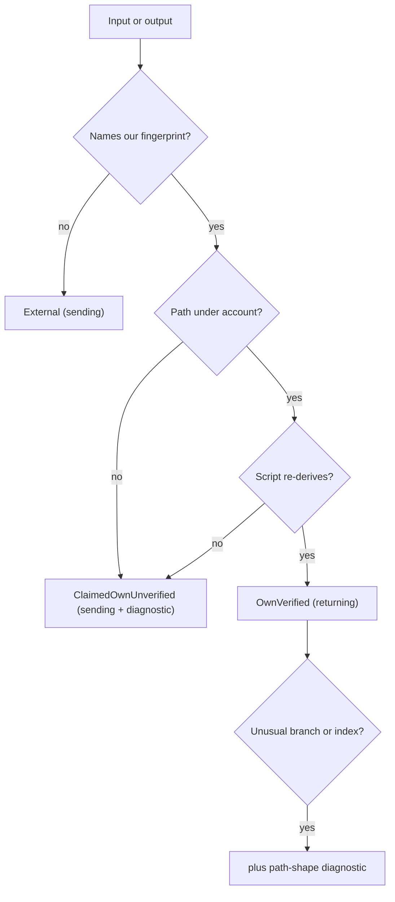

| | |
|---|---|
| **Number** | VSP-BTC-1 |
| **Status** | RFC, open for review |
| **Tracking issue** | [#640](https://github.com/anchorageoss/visualsign-parser/issues/640) |
| **Scope** | the `bitcoinlike` family: Bitcoin, its test networks, and same-format forks (Pearl first) |

## Summary

Let an approver tell their own coins from everyone else's. Today the Bitcoin
parser renders every PSBT output as a bare address, so "pay 0.0006 BTC and
return 0.00039 BTC as change" looks the same as "send 0.00099 BTC away".

This RFC adds wallet context as signed request metadata:

- **Network**, so a fork that shares Bitcoin's format (Pearl) is rendered with
  its own addresses, unit and rules, never as Bitcoin.
- **Accounts** (xpubs with key origin), so the parser can prove an input or
  output belongs to the wallet by re-deriving its script.
- **Previous transactions**, so amounts and fees can be verified where the
  signature doesn't commit to them.
- **Labels** (deposit IDs, invoice references), shown as attributed text.

Two rules govern all of it:

1. **Metadata is a set of hints the parser proves or attributes, never a source
   of conclusions.** An output is "yours" only when the parser re-derives its
   script. A label is shown as a label with its source, never in place of an
   address or amount.
2. **Every piece of context the metadata contributes is visible in the payload,
   with its source.** Nothing metadata-derived is applied silently, and nothing
   changes when no metadata is supplied.

## Before and after

The same transaction, a P2WPKH spend of 0.001 BTC: 0.0006 BTC to a payee and
0.00039 BTC to change. The screens are rendered from the prototype's actual
payload JSON. Rows marked ◆ were added by metadata, and ▲ marks a warning.

<Tabs>
  <Tab title="Today, no metadata">
    

    Payload: [payload-before.json](https://github.com/anchorageoss/visualsign-parser/blob/main/docs/images/rfcs/vsp-btc-1/payload-before.json)
  </Tab>
  <Tab title="With wallet metadata">
    

    Payload: [payload-after.json](https://github.com/anchorageoss/visualsign-parser/blob/main/docs/images/rfcs/vsp-btc-1/payload-after.json)
  </Tab>
</Tabs>

Today nothing distinguishes output 1 from the payment, the input amount is
claimed, and the fee is unknown. With metadata:

- output 1 is change, re-derived from the Savings account;
- the input amount and fee are verified, from a previous transaction the
  metadata supplied;
- labels appear, each attributed to the metadata.

The same output in JSON, trimmed to the fields that differ:

<CodeGroup>

```json Before
{
  "Label": "Output 1",
  "Type": "preview_layout",
  "PreviewLayout": {
    "Subtitle": {
      "Text": "bc1qschdw5sg…05tjl3 0.00039000 BTC"
    },
    "Expanded": { "Fields": [
      {
        "Label": "Address",
        "Type": "address_v2",
        "AddressV2": { "Address": "bc1qschdw5sg…05tjl3" }
      }
    ] }
  }
}
```

```json After
{
  "Label": "Output 1",
  "Type": "preview_layout",
  "PreviewLayout": {
    "Subtitle": {
      "Text": "Change - Savings (m/84'/0'/0'/1/7) - verified from wallet metadata | bc1qschdw5sg…05tjl3 0.00039000 BTC"
    },
    "Expanded": { "Fields": [
      {
        "Label": "Ownership",
        "Type": "text_v2",
        "TextV2": { "Text": "Change - Savings (m/84'/0'/0'/1/7) - verified from wallet metadata" }
      },
      {
        "Label": "Address",
        "Type": "address_v2",
        "AddressV2": { "Address": "bc1qschdw5sg…05tjl3" }
      }
    ] }
  }
}
```

</CodeGroup>

The attack this stops: the PSBT carries the wallet's fingerprint and a change
path next to an output that pays someone else. The parser can't re-derive it,
so it is counted as sending and flagged.


[payload-fake-change.json](https://github.com/anchorageoss/visualsign-parser/blob/main/docs/images/rfcs/vsp-btc-1/payload-fake-change.json)

<Note>
These screens are prototype output and use its interim wording. This RFC
changes four things:

- The Sending and Returning totals become `amount_v2` (they are `text_v2`
  today).
- Warnings become `diagnostic` fields (they are `text_v2` today).
- Labels move after the address, out of the subtitle.
- "wallet metadata" is replaced with the signer's name and the account
  fingerprint ([Display](#display)).
</Note>

## Prior art

Every signer surveyed treats a PSBT's derivation claims as hints. Change is
accepted only after re-deriving the script from an account the device already
trusts:

| Signer | Where the trusted account comes from | Change rule |
|---|---|---|
| Trezor (`change_detector.py`) | the inputs being spent | same script type, path prefix and multisig fingerprint as the inputs; change chain ≤ 1; index ≤ 1,000,000 |
| Ledger (`app-bitcoin-new`, `preprocess_outputs.c`) | a BIP-388 wallet policy registered on device, or a default single-sig policy | key origin matches a policy key; script re-derived under the same policy; at most 10 change outputs |
| Coldcard (`consider_dangerous_change`) | the inputs, or a registered multisig wallet | warns on unusual path shape, or an index more than 200 past the inputs |
| Bitcoin Core | the wallet database | IsMine and not in the address book |

Two lessons carry over:

- **Re-derive, never trust the claim.**
- **The account set itself needs an anchor.** Re-deriving proves an output
  matches *an account the request supplied*, not that the account is the
  wallet's. Hardware wallets solve this with on-device registration (BIP-388).
  The enclave has no registration step, so this RFC anchors the account set
  with a metadata signature from an allowlisted key
  ([Attestation](#attestation)).

No hardware signer displays host-supplied labels. BIP-329 is the closest format:
JSON Lines records keyed by `txid:vout`, unauthenticated.

## Request flow



1. The wallet backend signs `BitcoinLikeMetadata` under the
   `bitcoin-wallet-metadata` tag, scoped to the network, `wallet_id` and
   unsigned txid.
2. It sends the PSBT with the metadata in `ChainMetadata.bitcoin_like`.
3. The signing service relays the parse request to the enclave.
4. The enclave verifies the signature against the wallet-scoped, named
   allowlist.
5. It validates the metadata, merges previous transactions, re-derives scripts
   and classifies every input and output.
6. The approver sees a `SignablePayload` whose metadata rows name the signer,
   signed by the enclave over `input_payload_digest` and `metadata_digest`.

The parse-request stamp authenticates transport. It isn't treated as
attestation of the metadata, which carries its own signature so that its
attester is known regardless of who relays it.

## Proto

```protobuf
message ChainMetadata {
  oneof metadata {
    EthereumMetadata ethereum = 1;
    SolanaMetadata solana = 2;
    NearMetadata near = 3;
    BitcoinLikeMetadata bitcoin_like = 4;   // appended: existing digests unchanged
  }
}

message BitcoinLikeMetadata {
  BitcoinLikeNetwork network = 1;
  string wallet_id = 2;                     // the wallet the signer key is enrolled for
  repeated BitcoinLikeAccount accounts = 3;
  repeated BitcoinLikePrevout prevouts = 4;
  repeated BitcoinLikeLabel labels = 5;
  optional SignatureMetadata signature = 6;
}

// Every value carries the enum's name: proto3 enum values are package-scoped.
enum BitcoinLikeNetwork {
  BITCOIN_LIKE_NETWORK_UNSPECIFIED = 0;     // bitcoin mainnet
  // bitcoinlike:bitcoin
  BITCOIN_LIKE_NETWORK_BITCOIN_MAINNET = 1;
  BITCOIN_LIKE_NETWORK_BITCOIN_TESTNET4 = 2;
  BITCOIN_LIKE_NETWORK_BITCOIN_SIGNET = 3;
  BITCOIN_LIKE_NETWORK_BITCOIN_REGTEST = 4;
  reserved 5 to 99;
  // bitcoinlike:pearl
  BITCOIN_LIKE_NETWORK_PEARL_MAINNET = 100;
  BITCOIN_LIKE_NETWORK_PEARL_TESTNET2 = 101;
  BITCOIN_LIKE_NETWORK_PEARL_REGNET = 102;
}

message BitcoinLikeAccount {
  string name = 1;                          // display name, e.g. "Savings"
  string master_fingerprint = 2;            // 8 hex chars
  string origin_path = 3;                   // e.g. "m/84'/0'/0'"
  string xpub = 4;
  BitcoinLikeScriptType script_type = 5;    // P2PKH, P2SH_P2WPKH, P2WPKH, P2TR
  optional uint32 highest_index = 6;        // highest issued address index
}

message BitcoinLikePrevout {
  string txid = 1;
  string tx_hex = 2;                        // hex, as Solana's simulated_transaction_result
}

message BitcoinLikeLabel {
  oneof target {
    string outpoint = 1;                    // "txid:vout", an input
    uint32 output_index = 2;                // an output of this transaction
  }
  string text = 3;
}
```

- `metadata_digest` already covers `ChainMetadata`, so the metadata used for a
  parse is bound into the enclave-signed response with no further plumbing.
- A test pins the Borsh discriminant bytes of `ethereum`, `solana` and `near`
  before `bitcoin_like` lands, so appending it can't change existing digests.
- Binary data travels as hex strings, so the host-side JSON forms stay readable.
- Accounts use explicit xpub + origin rather than descriptor strings, so the
  first version needs no descriptor parser in the enclave.

## Networks and forks

A PSBT doesn't name its network, and some forks share Bitcoin's transaction
format byte for byte. Pearl is the first: Taproot-only spends, plain BIP-341
sighash, the same BIP-174 PSBT magic, but a `prl` address prefix and a 2.1
billion PRL supply cap. Without a network, the enclave would render a Pearl
PSBT with `bc1p…` addresses and BTC amounts, or reject it as over Bitcoin's
21 million cap.

**Why a closed enum per chain.** Alternatives considered:

| Option | Verdict |
|---|---|
| Closed `BitcoinLikeNetwork` enum inside `BitcoinLikeMetadata` | **Chosen.** Pearl values exist only in Bitcoin-like metadata, so they can never be a valid network for another chain. An unknown number from a newer client is rejected, never treated as mainnet. |
| Shared fork-id string across chains | Puts every chain's forks in one namespace; a misrouted id would reach a chain that treats unknown metadata as mainnet. |
| `oneof` of per-fork messages | Pearl carries no fields Bitcoin lacks, so each branch would be an empty message acting as an enum. A fork that needs its own fields later gets an optional message next to `network`. |
| New `Chain` value per fork | `Chain` says which parser runs. It's right when the transaction format differs (Zcash). Pearl's format is Bitcoin's. |

**Families in Rust.** The wire value becomes a type at one boundary:



```rust
mod sealed { pub trait Sealed {} }

pub trait Family: sealed::Sealed + 'static {
    type Net: Copy;
    const ID: &'static str;        // "bitcoinlike:pearl"
    const NAME: &'static str;      // "Pearl"
    const TICKER: &'static str;    // "PRL"
    const MAX_MONEY: u64;          // base units
    const ASSURANCES: Assurances;  // what the parser checks for this family
    fn hrp(net: Self::Net) -> Hrp;
    fn script_allowed(c: ScriptClass) -> bool;
}

pub enum Selected {
    Bitcoin(BitcoinNet),
    #[cfg(feature = "bitcoinlike-pearl")]
    Pearl(PearlNet),
}
```

- **One boundary.** `TryFrom<Option<&ChainMetadata>> for Selected` is the only
  code that reads the wire value, and the match on `Selected` is exhaustive.
- **Shared analysis stays network-free.** Prevout checks and fee classification
  take the supply cap as a value. Only rendering (address encoding, unit, script
  policy) is generic over `F: Family`.
- **No `bitcoin::Network` past the boundary.** `Address::from_script` only knows
  Bitcoin's prefixes, so rendering encodes with `F::hrp`.
- **Sealed families.** Only the crate defines a family.

**Naming.** Every family sits under the `bitcoinlike` namespace:
`bitcoinlike:bitcoin` and `bitcoinlike:pearl`, with a network suffix such as
`bitcoinlike:pearl/mainnet`. Proto spells it `BITCOIN_LIKE_NETWORK_*`, Rust
`family::Pearl`, and Cargo `bitcoinlike-pearl`. `Chain` stays `CHAIN_BITCOIN`.

**When a fork gets its own family.** A test network is a network value, not a
family. A chain gets its own family when it diverges in a way the signer must
know about: supply cap, address encoding, allowed scripts, or any assurance that
changes meaning. A divergence that needs its own transaction parser is a new
`Chain` value instead.

**Assurances by family** (proposed; each row becomes a test):

| Assurance | `bitcoinlike:bitcoin` | `bitcoinlike:pearl` |
|---|---|---|
| Fee verified from previous transactions | yes | yes |
| Taproot fee bound by the BIP-341 signature | when every input is P2TR | the normal case: standard inputs are P2TR |
| Legacy and segwit v0 scripts | rendered | refused (not standard) |
| Base58 addresses | rendered | refused (none exist) |
| P2MR (witness v2) and `OP_CHECKXMSSSIG` | not applicable | refused until modeled |
| Ownership re-derivation | BIP-44/49/84/86, coin type 0 | BIP-86 only, coin type 808276 (1 on testnets) |
| Multisig | `wsh(sortedmulti)`, `tr` `multi_a` | `tr` `multi_a` only |
| Signature binds the network | no | no |

Pearl parameters come from its public node source (`pearl-research-labs/pearl`
at `d7c517d`: `chaincfg/params.go`, `blockchain/validate.go`,
`btcutil/address.go`, `txscript/sighash.go`).

**Cargo features.** `bitcoinlike-pearl = ["bitcoin",
"visualsign-bitcoin/bitcoinlike-pearl"]` in parser_app, http-server and
parser_cli. Defaults and images don't include Pearl until it has its own
tracking issue. Cargo unifies features within one build, so:

- production binaries are built per package, as the images already are;
- the compiled families are exposed in the health or version response, for CI
  to compare with `CHAIN_FEATURES`;
- a default-features test asserts that `BITCOIN_LIKE_NETWORK_PEARL_MAINNET` is
  rejected.

**Other candidates** (to be confirmed per chain):

| Chain | Fits as | Why |
|---|---|---|
| Litecoin | family, if MWEB is refused | Bitcoin format and sighash; MWEB is an extension block that needs its own rendering |
| Dogecoin | family | Bitcoin legacy format; no segwit, so every amount needs its previous transaction; no PSBT standard yet |
| Bitcoin Cash | `Chain` value | `SIGHASH_FORKID` and CashTokens change the signed digest and the output format |
| Liquid | `Chain` value | confidential transactions and PSET |

<Warning>
A PSBT carries nothing that names its network, and a Pearl Taproot script is a
valid Bitcoin script. A Pearl PSBT sent with no metadata renders as Bitcoin
mainnet. The defences are the network shown on every payload, the network
inside the signed metadata scope, and the integration always sending `network`
for anything other than Bitcoin.
</Warning>

## Attestation

Metadata is trusted only when signed by an allowlisted key, through the
mechanism the Ethereum ABI, Solana IDL and NEAR token-metadata paths already use
(`visualsign/src/signing.rs`).

**Signature.** `metadata_signing_prehash_v1(chain_tag, scope, body)`:

- `chain_tag`: `bitcoin-wallet-metadata`, so a signature for another chain's
  metadata never verifies here.
- `scope`: the length-prefixed network enum value, `wallet_id` and unsigned
  txid. Binding the txid stops replay onto a different transaction. Binding the
  network stops a Bitcoin signature being presented for Pearl.
- `body`: the Borsh encoding of `BitcoinLikeMetadata` with `signature` cleared.

**Policy.** The converter takes a deploy-time `MetadataTrustPolicy`, as NEAR's
does. Production runs `RequireAllowlistedSigner`, and nothing in a request can
change the posture.

### Trust anchors

The parser always does the same thing: it verifies one signature against the
allowlist and re-derives every script. What differs is why the allowlisted key
deserves trust, and so what a compromised component can do:

| Anchor | The key is held by | Who decides which accounts are "yours" | If the backend is compromised |
|---|---|---|---|
| Backend key | the wallet backend | the backend, per request | it can list an attacker's xpub as an account |
| **Wallet enclave** (recommended) | an attested enclave that holds the wallet; the key never leaves it | a one-time registration into the enclave, under its own approvals | it can't add an account; it can only send requests the enclave answers from registered accounts |
| Pinned account set | nobody: a hash of the account set is pinned in deploy-time config | a redeploy | it can't add an account |

**Wallet enclave.** The wallet (descriptors, issued-index state, labels, and
the previous transactions it has seen) lives in an enclave. Given a PSBT, it
returns the signed `BitcoinLikeMetadata` subset for that transaction:



1. The backend sends the PSBT to the wallet enclave.
2. The wallet enclave selects the registered accounts the PSBT's derivations
   name, the previous transactions it spends, and the labels for its outpoints
   and outputs.
3. It signs that subset with its enclave-held key, scoped to the network,
   `wallet_id` and unsigned txid, with its snapshot height.
4. The backend forwards the PSBT and signed metadata, as with any other anchor.
5. The parser recognizes the wallet enclave's key and checks every claim
   against the PSBT. It still never trusts the metadata's conclusions.
6. The approver sees `Wallet treasury-1 - account list signed by Wallet enclave
   (attested) - snapshot at block 870123`.

This is the BIP-388 model moved off the device. Registration is the trust root
and happens once per account, under its own approvals. After that, a
compromised backend can only ask questions about registered accounts.

- **Enrollment.** The wallet enclave's key is enrolled only after its
  attestation is verified, the same way the visualsign enclave's own signing
  key is tied to its boot attestation. The allowlist entry records the name and
  the measurements that were checked.
- **The parser stays stateless.** It verifies a signature, as for any anchor,
  and needs no attestation parser of its own.
- **Registration is the new attack surface.** Whoever can import descriptors
  into the wallet enclave decides what "yours" means, so registration needs
  approvals at least as strong as those on the transactions it affects.
- **Freshness.** The signed metadata carries the snapshot height, and the
  parser shows it.

**Keys per wallet.** Allowlist entries are scoped as `(chain_tag, wallet_id,
pubkey)`, length-prefixed as NEAR's `scoped_signer_key(domain, pubkey)`. One key
can serve many wallets, or each wallet can have its own; that is configuration,
not code. A key enrolled for wallet A can't vouch for wallet B, but it can vouch
for any account in wallet A, so high-value wallets should have their own keys.

**Named entries.** `SignerAllowlist` gains an optional display name per key,
from deploy-time configuration only, never from the request. The change is
additive: a map instead of a set, `insert` and `contains` unchanged, and
`insert_named` and `name_of` added. Env vars accept `name=hexkey` as well as a
bare `hexkey`. Names are checked at load time: printable ASCII, at most 32
characters, passing `validate_charset`. Every chain that uses the allowlist can
then render a signer name.

**Unsigned or unrecognized metadata.** Under `RequireAllowlistedSigner` the
request fails with the reason. Under `AcceptUnsigned` (dev and CLI only) every
row says `unsigned request metadata` in place of a signer name, following NEAR's
`TokenProvenance::Unsigned`.

## Verification

All metadata is validated before any of it is used. Any failure rejects the
whole request with `Invalid wallet metadata: <reason>`. Nothing is dropped
silently.

**1. Validate.** The checks:

- the signature verifies under the policy;
- the network matches the family;
- each account's xpub depth and child number agree with its `origin_path`, and
  its coin type matches the family;
- each prevout's `tx_hex` hashes to its `txid`, and that txid is spent by this
  transaction;
- each label targets an outpoint this transaction spends or an output it has,
  once;
- label text is 1–64 printable ASCII characters (relaxed only by
  [#622](https://github.com/anchorageoss/visualsign-parser/issues/622)).

**2. Merge previous transactions.** Each prevout the PSBT lacks becomes its
`non_witness_utxo`, and the existing analysis runs unchanged. A prevout that
contradicts `witness_utxo` is rejected.

**3. Classify each input and output.**



- **Names our fingerprint:** a `bip32_derivation` or `tap_key_origins` entry
  carries an account's master fingerprint.
- **Path under account:** the path is the account's origin plus two unhardened
  steps (branch and index).
- **Script re-derives:** the script built from the xpub at that path equals the
  actual `scriptPubKey` (for an input, the prevout script).
- **Unusual branch or index:** a branch other than 0 or 1, or an index above
  `highest_index`.

An output that is ours but has no derivation data is External. That
undercounts the wallet but never overstates it.

## Display

Facts from the transaction (address, amount, script type, outpoint, fee) keep
their existing fields and text. Metadata only adds fields, using the types the
Anchorage wallet renders
([render rules](https://github.com/anchorageoss/visualsign-parser/blob/main/docs/specs/anchorage-wallet-render-rules.md)):
`text_v2`, `address_v2`, `amount_v2` and `diagnostic`, inside
`preview_layout`.

**Summary** (first field):

- `Sending` (`amount_v2`): every output not `OwnVerified`, with "includes N
  falsely claiming to be yours" when any are claimed.
- `Returning to your accounts` (`amount_v2`).
- `Fee`, as today.
- `Network` (`text_v2`), from the family: `Pearl mainnet (from signed wallet
  metadata)`.
- `Ownership Source` (`text_v2`): `Wallet treasury-1 - account list signed by
  Anchorage BTC ops (03a1…9f), checked against the transaction`.

**Per input and output**, before the existing fields:

| Status | Text |
|---|---|
| Change, verified | `Change - Savings [73c5da0a] m/84'/0'/0'/1/7 - verified` |
| Own input, verified | `From your account - Savings [73c5da0a] m/84'/0'/0'/0/3 - verified` |
| Claimed but contradicted | `diagnostic`: `Claims to be your change but does not derive from account Savings; counted as sending` |
| Unusual path | `diagnostic`: `Unusual derivation path for account Savings: <why>` |
| External | `External - not an account in this wallet's metadata` |
| Label | `Label: Deposit #1234 (from wallet metadata)`, after the address |

- **Fingerprints on screen** on every own row, so a human can notice an
  unexpected account.
- **Labels after the address, never in the subtitle.** A label beside an
  external address ("Invoice (Acme Corp)") is the address-poisoning pattern.
- **"Verified" on inputs** means the prevout script re-derives. The amount is
  verified only with the full previous transaction, and `Amount Source` says
  which.
- **No metadata, no change.** The payload is byte-identical to today, and all
  golden fixtures are unchanged.

## Intermediate output

An opt-in Borsh `intermediate_output` carries the classification, so policy
engines that consume visualsign can enforce on it:

```rust
pub struct BitcoinLikeOwnershipV1 {
    pub family: String,                 // "bitcoinlike:bitcoin"
    pub network: i32,                   // BitcoinLikeNetwork value
    pub wallet_id: String,
    pub signer: Option<[u8; 33]>,
    pub inputs: Vec<Ownership>,
    pub outputs: Vec<Ownership>,
    pub sending_base_units: u64,
    pub returning_base_units: u64,
}

pub enum Ownership {
    OwnVerified { account: u32, branch: u32, index: u32 },
    ClaimedOwnUnverified { reason: String },
    External,
}
```

Turnkey's policy engine evaluates its own parse of the transaction
(`bitcoin.tx.outputs`, `bitcoin.tx.inputs`, `bitcoin.tx.fee`), not visualsign
output. Ownership shown here informs the approver but doesn't constrain Turnkey
policy unless the backend restates it there, for example as an allowlist of
change addresses or a consensus rule requiring an independent approver.

## Threats

| Threat | Signature | Parser check | Display |
|---|---|---|---|
| Client edits or injects metadata | stops it | re-derive; re-hash prevouts | every row names the signer |
| Signer key compromised | no | stops fake change against honest accounts, not a substituted account | fingerprints on screen; per-wallet keys limit reach; independent approver |
| Backend compromised, wallet-enclave anchor | n/a | the enclave answers only from registered accounts | registration approvals; snapshot height on screen |
| Fake change (our fingerprint, foreign script) | n/a | `ClaimedOwnUnverified`, counted as sending | `diagnostic` |
| Ransom change (our key, odd path) | n/a | branch and `highest_index` bounds | `diagnostic` |
| Input amount lie (CVE-2020-14199) | no | prevout must hash to txid and agree with `witness_utxo` | amount shown as claimed otherwise |
| Metadata replayed onto another transaction | txid in scope | every target must exist in the transaction | `metadata_digest` in the signed response |
| Fork PSBT rendered as Bitcoin, or the reverse | network in scope | family script policy refuses what the fork doesn't allow | network on every payload |
| Multisig cosigner swap | no | out of scope until the multisig follow-up | single-sig only |
| Label spoofing or bidi tricks | limits who writes labels | ASCII, length cap, target must exist | label after the address, attributed |

## Alternatives considered

**Trust the PSBT's derivation data alone.** Rejected: that is exactly the claim
fake change forges. Derivation data without metadata still never yields change.

**Treat the parse-request stamp as attestation.** Rejected: the stamp
authenticates whoever sent the request, not who vouched for the wallet context.

**Read a wallet file (`wallet.dat`), hosted or signed.** The idea is to give the
parser the wallet itself, so ownership, labels and history come from one place.
Rejected as a format, kept as a source:

- **Private keys.** A `wallet.dat` holds private keys unless it is watch-only.
  Even an encrypted one shouldn't enter a request path.
- **Parser surface.** Bitcoin Core wallets are BerkeleyDB or SQLite databases.
  Parsing them in the enclave adds a large, C-backed decoder for data the parser
  mostly doesn't need.
- **Size and statelessness.** A wallet grows with its history, and the enclave
  is stateless with no outbound network. A hosted wallet would have to be
  fetched per request, which breaks reproducibility, or shipped whole every
  time.
- **Freshness.** A synced copy is still a snapshot. What matters is how stale it
  is, and a file doesn't say so on screen.

What works instead is a **signed watch-only snapshot**, with the wallet as its
source. The backend exports from a descriptor wallet and sends only the part
relevant to this transaction:

| `BitcoinLikeMetadata` field | Exported from |
|---|---|
| `accounts` (and `highest_index`) | `listdescriptors` (public descriptors, ranges, next index) |
| `prevouts` | `gettransaction` or `getrawtransaction` for each spent outpoint |
| `labels` | a BIP-329 export, filtered to this transaction's outpoints and outputs |

Three additions follow from the wallet-file idea:

- **The wallet can run in an enclave.** The snapshot's producer can be an
  attested wallet enclave that holds the wallet and signs each answer. For the
  parser that is the same as trusting an allowlisted key, but the key's trust
  comes from measured code and a one-time registration rather than from the
  backend ([Trust anchors](#trust-anchors)).
- **Snapshot freshness on screen.** An optional `snapshot_height` and
  `exported_at`, signed with the rest, shown as `Wallet snapshot at block
  870123`.
- **Pinned account sets.** For wallets whose accounts never change (cold
  treasuries), a hash of the account set can be pinned in deploy-time config.
  That anchors ownership without trusting any signing key.

## Producer helpers

Whatever the anchor, something has to build and sign the metadata. These
helpers keep producers and the parser on one implementation:

1. **A shared metadata crate** (pure Rust, no C). It holds the
   `BitcoinLikeMetadata` types, the canonical Borsh body, the prehash (reusing
   `metadata_signing_prehash_v1`), and `sign` / `verify`. The wallet enclave,
   any backend and the parser link the same code, so the signed bytes can't
   drift between producer and verifier.
2. **A metadata builder:** `build_metadata(psbt, source)` over a
   `WalletSource` trait. It returns only what this transaction needs: the
   registered accounts its derivations name, the previous transactions it
   spends, and the labels for its outpoints and outputs. Two implementations:
   - **BDK** (`bdk_wallet`, pure Rust), which suits an enclave and needs no
     `wallet.dat`.
   - **Bitcoin Core RPC** (`listdescriptors`, `gettransaction`, a BIP-329
     export), for backends that already run Core.
3. **An enrollment tool.** It verifies a wallet enclave's attestation and prints
   the named allowlist entry (`name=pubkey`) with the measurements it checked,
   ready for deploy-time config.
4. **Parser CLI support.** `--wallet-metadata <file>` plus a dev-key signer, so
   the whole flow can be tested locally without an enclave.

## Multisig (follow-up)

A `BitcoinLikeMultisigAccount` carries the threshold, sorted cosigner xpubs with
origins, and the script type. An output is change only if it re-derives under
the identical cosigner set and threshold as the inputs being spent, at the same
branch and index for every cosigner. That is Trezor's rule, and it defeats
index-randomizing ransom attacks. Descriptor strings (BIP-380 to 386) can replace
the structured form once the enclave takes a descriptor parser.

## Prototype

A single-sig prototype exists in `visualsign-bitcoin` (not yet merged). It
covers P2PKH, P2SH-P2WPKH, P2WPKH and BIP-86 P2TR, and has no proto wiring,
signature check or network families yet. Its 14 tests cover:

- verified change (P2WPKH, P2TR) and fake change;
- an unknown outpoint, a wrong-txid prevout, and a prevout contradicting
  `witness_utxo`;
- a network mismatch, unusual branches, paths outside the account, and hardened
  sub-paths.

All golden fixtures are unchanged. The screens and JSON above are its output.

## Rollout

1. **Shared allowlist names** (`SignerAllowlist`; useful to every chain).
2. **Wiring and networks.** `BitcoinLikeMetadata` with `network`, the Borsh
   discriminant pin, families with Bitcoin only, docs, and the regtest invariant
   (derivation data without metadata never yields change).
3. **Ownership, attestation and display.** Accounts, prevouts and labels; the
   signature check with per-wallet scoping; the signer name on screen; the
   `intermediate_output`.
4. **Producer helpers.** The shared metadata crate and the BDK builder first,
   then the Core RPC source, the enrollment tool and CLI support.
5. **Wallet enclave** as the recommended anchor, with registration approvals
   and snapshot freshness.
6. **Pearl**, behind `bitcoinlike-pearl`, with its own tracking issue.
7. **Multisig and descriptors.**

## Open questions

1. **Contradicted claims:** warn and count as sending (prototype), or fail the
   request?
2. **Labels on external outputs:** allow them, or only on own coins?
3. **Wording before attestation lands:** "your accounts" or "accounts in this
   request"?
4. **Segwit v0 prevouts:** required before an own input is called verified?
5. **Enrollment:** per-wallet keys in deploy-time config, or a root key issuing
   per-wallet certificates? (This matters most for the backend-key anchor.)
6. **Descriptors:** take `miniscript` into the enclave, or a narrow parser for
   `wpkh`, `tr` and `wsh(sortedmulti)`?
7. **Snapshot freshness:** required, optional, or shown only when older than a
   bound?
8. **Wallet enclave:** where it runs, who approves account registration, and
   which attestation format the enrollment tool verifies.
