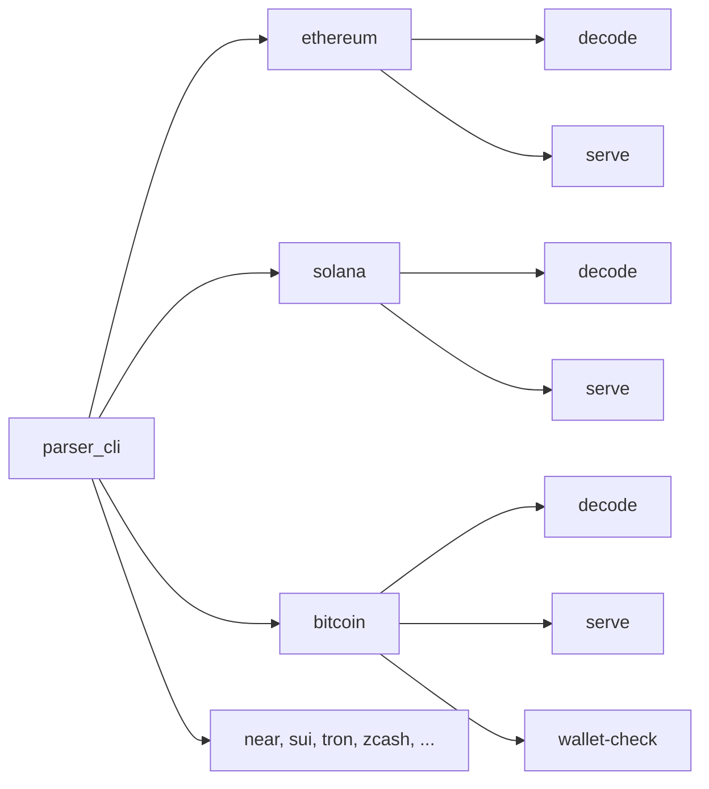

| | |
|---|---|
| **Number** | VSP-CORE-1 |
| **Status** | RFC, open for review |
| **Scope** | `parser_cli` (all chains); `parser_cli_core::ChainPlugin` |

## Summary

`parser_cli` flattens every chain's flags into one namespace. `decode` and
`serve` accept Solana's `--simulated-tx-result` when you decode Ethereum, and
Bitcoin's `--bitcoin-network` next to the shared `--network`. Each new chain
adds more top-level flags, and chain-specific tools have nowhere to go.

This RFC makes the chain the first word of every command:

```bash
parser_cli <chain> <command> [flags]
```

```bash
parser_cli solana decode -t <tx> --simulated-tx-result <b64>
parser_cli bitcoin decode -t <psbt> --network regtest
parser_cli bitcoin wallet-check --psbt @spend.psbt --rpc-url http://127.0.0.1:8332 ...
parser_cli ethereum serve --dir ./txs
```

Each chain owns its flags, its `--network` values, its help text and any tools
of its own. `parser_cli decode --chain <chain>` keeps working through a
deprecation window, with identical output.

## The problem

Today `decode` and `serve` both flatten a `ChainArgs` struct holding every
compiled chain's arguments (`parser/cli/src/main.rs`). Every invocation parses
every chain's flags and builds every chain's plugin, and then
`parser_cli_core::run` picks one by the `--chain` string.

| Flag | Owner | Today |
|---|---|---|
| `--chain`, `-t`, `-o`, `--condensed-only`, `--with-intermediate` | shared | top level |
| `--network` | shared, interpreted per chain (EVM chain ID, canonical name) | top level |
| `--abi-json-mappings`, `--abi-proxy-mappings` | Ethereum | top level |
| `--idl-json-mappings`, `--simulated-tx-result`, `--max-fee-lamports` | Solana | top level |
| `--near-token-metadata-mappings` | NEAR | top level |
| `--bitcoin-network` | Bitcoin | top level, next to `--network` |

What goes wrong:

- **Flags are accepted where they mean nothing.** `decode --chain ethereum
  --max-fee-lamports 5000` parses and silently ignores the Solana flag.
- **Two network flags.** Bitcoin can't use the shared `--network` because its
  values (`bitcoin`, `testnet4`, `signet`, `regtest`) mean nothing to other
  chains, so it added `--bitcoin-network`.
- **Names carry their chain as a prefix** (`--near-token-metadata-mappings`) to
  avoid collisions, and the prefixes grow with every chain.
- **Help is one long list.** `parser_cli decode --help` shows every compiled
  chain's flags, with no way to see one chain's.
- **Chain tools have no home.** Checking a PSBT against a local Bitcoin node
  ([VSP-BTC-1](/rfcs/btc/vsp-btc-1#walkthrough-check-against-your-own-wallet-before-signing))
  needs its own flags and isn't a decode. It shouldn't add top-level flags.
- **Every plugin is built on every run.** A bad value for one chain's flag can
  only be reported lazily, because `register` can't fail (Bitcoin's plugin
  falls back to mainnet in `register` and reports the error later).

## Proposal

### Command shape



- **The chain is a subcommand.** A chain that isn't compiled in has no
  subcommand, so clap reports `unrecognized subcommand 'bitcoin'` and
  `parser_cli --help` lists exactly the compiled chains.
- **`decode` and `serve` exist under every chain** and take the shared flags,
  minus `--chain`, plus that chain's own flags.
- **`--network` belongs to the chain.** Each chain declares its own values and
  help text: an EVM chain ID or name for Ethereum, `bitcoin`, `testnet4`,
  `signet` or `regtest` for Bitcoin. `--bitcoin-network` goes away.
- **Chain prefixes are dropped** inside the chain's scope. A name is kept where
  it describes the data rather than the chain.
- **Chain tools** are further subcommands, starting with `bitcoin
  wallet-check`.

| Today | Proposed |
|---|---|
| `decode --chain ethereum --abi-json-mappings ...` | `ethereum decode --abi-json-mappings ...` |
| `decode --chain ethereum --abi-proxy-mappings ...` | `ethereum decode --abi-proxy-mappings ...` |
| `decode --chain solana --idl-json-mappings ...` | `solana decode --idl-json-mappings ...` |
| `decode --chain solana --simulated-tx-result ...` | `solana decode --simulated-tx-result ...` |
| `decode --chain solana --max-fee-lamports ...` | `solana decode --max-fee-lamports ...` |
| `decode --chain near --near-token-metadata-mappings ...` | `near decode --token-metadata-mappings ...` |
| `decode --chain bitcoin --bitcoin-network regtest` | `bitcoin decode --network regtest` |
| `decode --chain ethereum --network 137` | `ethereum decode --network 137` |
| `serve --chain solana --dir ./txs` | `solana serve --dir ./txs` |

### Types

Each chain crate's `cli_plugin` exports one clap `Subcommand`. The shared decode
and serve flags become `DecodeShared` and `ServeShared` in `parser_cli_core`,
without `--chain` and `--network`:

```rust
// visualsign-solana/src/cli_plugin.rs
#[derive(clap::Subcommand, Debug)]
pub enum SolanaCommand {
    /// Decode a Solana transaction.
    Decode {
        #[command(flatten)]
        shared: parser_cli_core::DecodeShared,
        #[command(flatten)]
        args: SolanaArgs, // --network, --idl-json-mappings, --simulated-tx-result, ...
    },
    /// Serve a directory of Solana transactions.
    Serve {
        #[command(flatten)]
        shared: parser_cli_core::ServeShared,
        #[command(flatten)]
        args: SolanaArgs,
    },
}

impl SolanaCommand {
    pub fn run(&self) -> Result<(), String> { /* builds only SolanaPlugin */ }
}
```

```rust
// parser/cli/src/main.rs
#[derive(Subcommand, Debug)]
enum Command {
    #[cfg(feature = "ethereum")]
    #[command(subcommand)]
    Ethereum(visualsign_ethereum::EthereumCommand),
    #[cfg(feature = "solana")]
    #[command(subcommand)]
    Solana(visualsign_solana::SolanaCommand),
    #[cfg(feature = "bitcoin")]
    #[command(subcommand)]
    Bitcoin(visualsign_bitcoin::BitcoinCommand),
    // ... one arm per chain, behind its feature
    /// Deprecated: `parser_cli <chain> decode`.
    #[command(hide = true)]
    Decode(LegacyDecodeArgs),
}
```

- **Only the selected chain's plugin is built.** `ChainPlugin::register` can
  then fail with a clear error, and flag values are validated by clap at parse
  time.
- **`ChainPlugin` stays** as the decode engine's interface. `create_metadata`
  loses its shared `network: Option<String>` parameter, since the chain's args
  now carry the network.
- **Adding a chain** is one `Command` arm behind its feature, instead of a
  `ChainArgs` field plus a `build_plugins` push. The `chain-wiring` checker's
  `parser_cli` touch points change to match.

### Compatibility

`parser_cli decode --chain <chain> [flags]` (and `serve --chain`) stays for a
deprecation window:

- It is hidden from help, and parses today's flags exactly as today.
- It maps onto the new command and runs the same code, so **stdout is
  byte-identical**. Scripts that compare output keep working.
- It prints one line to **stderr**: `warning: 'decode --chain solana' is
  deprecated; use 'parser_cli solana decode'`.
- The CLI fixture tests run every fixture through both forms and require the
  same output. Once the window closes, the legacy form and its fixture copies
  are removed together.

## What changes

| Area | Change |
|---|---|
| `parser/cli/src/main.rs` | `Command` arms per chain; hidden legacy `Decode`/`Serve` |
| `parser/cli-core` | `DecodeShared` / `ServeShared`; `run` takes one plugin; `create_metadata` signature |
| Each `cli_plugin.rs` | a `<Chain>Command` subcommand; the chain's `--network` and value parser |
| `parser/cli/tests/cli_test.rs` and fixtures | fixtures move to `<chain> decode`; a legacy pass checks identical output |
| `serve` | per chain; the web UI is unchanged |
| Docs | `parser-cli.mdx`, `quickstart.mdx`, `adding-new-chain.mdx`, chain pages (`bitcoin.mdx`, `near.mdx`, `wallet-integration/dapps/ethereum.mdx`), the Ethereum `using_abijson` example README, and a changelog entry |
| `chain-wiring` (#616) | touch-point rules for the new `Command` arm |
| Open chain PRs | new chains add a `Command` arm instead of `ChainArgs` fields |

The enclave binaries (`parser_app`, http-server) are untouched. This changes
only the developer CLI.

## Alternatives considered

| Option | Verdict |
|---|---|
| **Chain first: `parser_cli <chain> <command>`** | **Chosen.** One namespace per chain for decode, serve and tools. `parser_cli bitcoin --help` shows everything Bitcoin supports. |
| Verb first: `parser_cli decode <chain>` | Keeps `decode` as the first word, but chain tools such as `wallet-check` need a second scheme (`parser_cli bitcoin wallet-check` next to `parser_cli decode bitcoin`). |
| Keep flat flags, add help headings and chain prefixes | Help gets grouped, but every flag is still accepted for every chain, and names keep growing prefixes. |
| Generic `--chain-arg key=value` | Stringly typed: loses clap's validation, completion and help. |

## Rollout

1. **Add chain-first commands** alongside the existing ones, sharing one code
   path. Bitcoin's prototyped `wallet-check` moves under it as written.
2. **Migrate the repo:** fixtures, tests, docs and examples, with the legacy
   pass proving identical output.
3. **Deprecate** `decode --chain` and `serve --chain` with the stderr warning.
4. **Remove** the legacy form after the window.

## Open questions

1. **Deprecation window:** a number of releases, or a date?
2. **`--network` defaults:** should every chain default to mainnet, or require
   `--network` where a wrong default changes rendering (Bitcoin forks)?
3. **Flag renames:** drop every chain prefix inside a chain's scope, or only
   prefixes that repeat the chain's name?
4. **A chain-agnostic `decode`:** is there a case for auto-detecting the chain
   from the input, or should the chain always be explicit?
